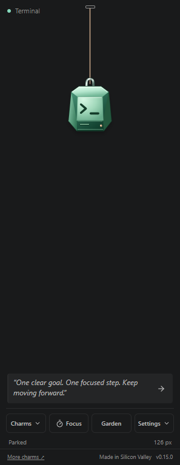
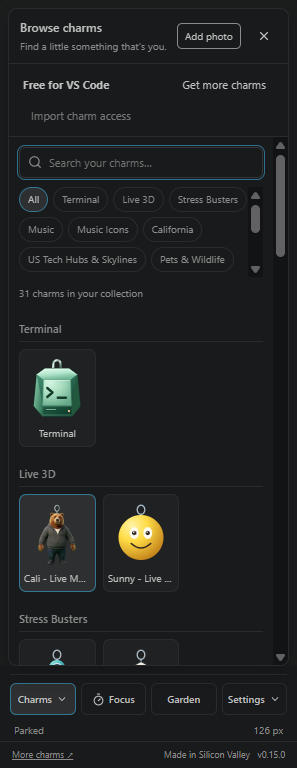
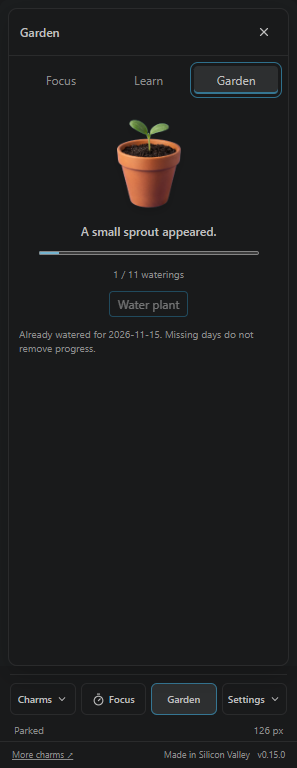

# CharmBits listing and launch copy

Prepared for the **0.15.0 review candidate**. Store publication and paid services are not live. The release checker still requires approved source/artwork terms, publisher access and successful CI on the release commit.

## Store fields

| Field | Prepared value |
|---|---|
| Name | CharmBits: Coding Charms |
| Short description | A free coding companion with focus, a daily garden, photo keepsakes and playful breaks. Optional paid charms. |
| Price | Free |
| Categories | Other |
| Keywords | charms, focus, productivity, garden, motivation, silicon, accessibility |
| Support | https://github.com/gautham-nvidia/charmbits/issues |
| Project | https://github.com/gautham-nvidia/charmbits |
| Privacy | Packaged `PRIVACY.md`; repository copy at `extension/PRIVACY.md` |
| Publisher | `gautham-nvidia`, subject to actual registry ownership verification |

The authoritative long description is [extension/README.md](../extension/README.md), so the VSIX and store listing do not drift into different feature promises.

Keep the existing extension identity `gautham-nvidia.charmlet`: it owns saved profiles and encrypted activations. The visible name is CharmBits. The Marketplace URL must use that identity after publisher ownership and the live listing have been verified.

## Product introduction

**A little play in your coding day.**

CharmBits puts a small, interactive companion in your VS Code sidebar. Start a focus session, discover a coding fact, take a gentle water break, or grow a surprise flower one day at a time.

The extension and all its features are free. Pick from 31 starter charms, import extra artwork and keep every flower you earn. Additional paid charms are optional. No account is needed for the extension, and its core tools work offline. Desktop retains its 30-day trial and optional Pro upgrade; Pro's charm collection can also be used in VS Code.

## Feature copy

- **Make your desk yours.** Search installed charms and switch collections in a visual picker. Pull a charm, release it and let it settle.
- **One thing at a time.** Choose a focus preset or your own duration, write an optional intention, and pause when you need to.
- **A small spark of curiosity.** Start with motivation, or switch to sourced coding, AI, GPU and testing facts and trivia.
- **Grow at your pace.** Plant a surprise seed and water once per local day. Your eleventh watering earns a permanent flower. Missing a day never removes progress.
- **Gentle reminders.** Optional water and movement cues offer Done, Snooze and Skip, with an option to wait for a focus break.
- **Free to import.** Bring a compatible charm pack into the extension. The importer and photo tools are free; additional charm purchases are optional.

## Screenshots and artwork

Use only captures of the actual reviewed version, in a disposable profile containing generated sample text. Show the version footer and original bundled artwork. Crop away unrelated editor panes and local filesystem paths rather than exposing a personal workspace.

The app, starter-picker and garden captures in `docs/store-assets/` show the installed 0.15.0 candidate in an isolated profile. The picker shows the actual 31-charm starter, rather than the retained beta collection. Historical captures remain in the versioned review records. The existing 256-pixel store icon is `extension/media/marketplace-icon.png`. A promotional image may reuse reviewed captures after the owner approves the final art lineup.

 

Use approved artwork in store materials. Do not claim NVIDIA sponsorship, imply that paid services are live, or advertise the unsigned desktop beta or website-only locket prototype as features delivered by the IDE listing.

## Release preparation

The active candidate is on `feat/phase-10-california-mascots` in draft PR #30. The publication workflow requires reviewed source on `main`, matching CI and the exact checked VSIX. Do not publish a different local package after verification.

Before activating a broader launch:

1. Verify publisher ownership, publication and the official store URL before replacing the website's null distribution links. Once configured, the homepage sends VS Code users directly to Marketplace without email signup. The app's More charms link uses the existing public gallery.
2. Approve source licensing and bundled artwork terms. Keep earned flowers, personal photos, previous purchases and legacy data available through upgrades.
3. Deploy the approved gallery, installation help, privacy and support pages. Check actual public downloads and mobile navigation.
4. Recheck installation from each live store and the declared supported editors. Report forks only after their real onboarding/runtime checks.
5. Complete native desktop input/monitor checks, signing/notarization and installer delivery before promoting the desktop app.
6. Complete merchant onboarding, purchase/refund/revocation checks and customer-facing terms before activating Photo Studio or paid packs.

## Marketplace account and publishing

The [official publishing guide](https://code.visualstudio.com/api/working-with-extensions/publishing-extension#publish-with-github-actions-and-trusted-publishing) recommends GitHub Trusted Publishing. The release workflow uses it with the pinned `@vscode/vsce` 4.1.1, whose CLI supports `--oidc`. This avoids storing a Marketplace personal access token in GitHub.

The owner must sign in to [Marketplace publisher management](https://marketplace.visualstudio.com/manage), verify ownership of **`gautham-nvidia`**, and create its Trusted Publishing policy:

| Policy field | Value |
|---|---|
| Repository owner | `gautham-nvidia` |
| Repository | `charmbits` |
| Workflow | `release.yml` |
| Environment | Leave empty; this workflow does not declare a GitHub environment |

The visible listing name is **CharmBits: Coding Charms**. Keep the extension identity **`gautham-nvidia.charmlet`** so existing installations retain their settings and activations. A matching publisher name alone does not prove ownership; the authenticated Marketplace account must own it.

Once source and artwork terms are approved, merge reviewed source to `main`, wait for CI at that exact commit, then use **Actions → Extension Release → Run workflow** with version `0.15.0` and destination `marketplace`. The default `artifact` destination only prepares a review download. The workflow validates the package, source state and terms before submitting the same VSIX. Open VSX is separate and still requires its own `OVSX_PAT` when selected.

As checked during preparation, the public extension lookup returned “Extension `gautham-nvidia.charmlet` not found,” GitHub had no repository Actions secrets, and the local publisher store was empty. Publisher ownership, the trusted policy and a live listing are still unverified. Do not set the website Marketplace link until the live listing installs successfully.

## Announcement draft — use only after the links exist

**Meet CharmBits: a little company while you code.** Add an interactive companion to your VS Code sidebar, focus on one task and grow a surprise flower at your own pace. All extension features are free, with 31 starter charms and optional paid charms. Your photos and progress stay on your device.

The final announcement needs verified installation/gallery links and the approved artwork selection before it can be posted. No announcement has been sent.
