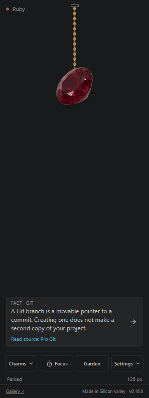
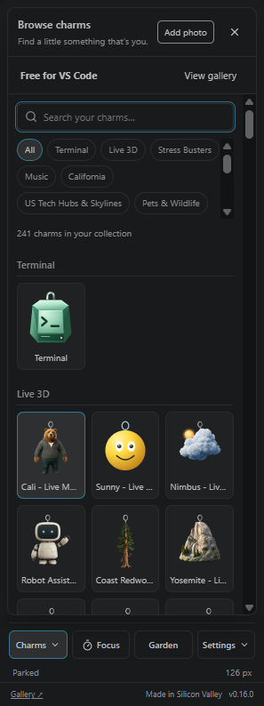
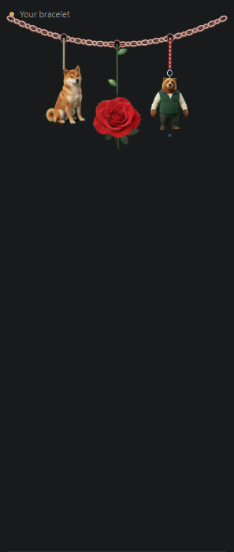

# CharmBits: Coding Charms

A little company while you code. Choose from **241 free charms**, tap a pet for a quiet response, or hang two or three favourites on a bracelet.

All released charms and extension features are free in VS Code and compatible extension hosts. There is no account, activation, payment or trial timer. Your settings, personal imports and progress carry forward when you update.

| Try | What you can do |
|---|---|
| Calm movement | Pull charms left or right, tap for a small response, and let them settle |
| Charm bracelet | Hang two or three charms on silver, gold, rose gold, woven linen or pearls |
| Pets and flowers | Pat a pet or tap a front-facing bloom attached to a leafy stem |
| Live companions | Spend a moment with Cali, Nimbus, Sunny or Robot Assistant |
| Focus and garden | Set a focus timer, record small wins and grow a flower |
| Photo keepsakes | Make a charm from a photo without uploading it |
| Quiet breaks | Try spinners, a twisty cube, sliding tiles or Lights Out |
| Motion controls | Pause decorative movement and honour your system's Reduced Motion setting |

**CharmBits candidate, version 0.16.0.** CharmBits lives in a dockable VS Code view, not over your code
or desktop. It uses supported APIs and does not modify your VS Code installation.
It also works in Restricted Mode without asking you to trust workspace code.

**Desktop is a separate edition** with a free starter, 30-day Pro trial and optional purchases. Desktop Pro is planned at $7.49 launch / $17.49 regular, paid once. Editor users do not need these purchases. [Desktop plans and availability](https://charmbits.pages.dev/shop.html).

 

## Try it

Install the candidate VSIX through **Extensions: Install from VSIX…**, or follow the
[source setup](https://github.com/gautham-nvidia/charmbits#readme).

CharmBits has its own Activity Bar container titled **CharmBits**. You can move it to the right sidebar using VS Code's view controls.

1. Open the Command Palette and run **CharmBits: Show Charm**.
2. For a right-side dock, run **View: Move View**, select **CharmBits**, then **New Secondary Side Bar Entry**.
3. Tap a charm, or use Space/Enter, for its response. All 23 pets have a quiet blink or breath; sleeping pets stay sleepy. Pull left or right and release to swing and settle. Reduced Motion returns directly to rest.
4. Click **Charms** to open the visual picker, search by name and filter installed collections. Choose **Settings → Appearance** for size, resting cord, visibility, motion and layout. The default 100% is 15% larger than earlier trials; adjust from 60% to 200% in 5% steps. Narrow views fit the charm to the available space.
5. Choose **Appearance → Arrangement → Charm bracelet** for two or three charms. Select each slot's charm, use the arrow buttons to reorder, or remove a slot. Tap or pull each charm independently. Switch back to **Single charm** at any time; Hanging and Orbit layouts remain available there.
6. Click **Focus** or run **CharmBits: Focus Session** for a focus/break timer with presets, custom minutes, pause/resume/stop and an optional intention.
7. Motivation is the fresh-state default, without a category heading. **Settings → Messages** offers Motivation, Facts + trivia, Facts or Trivia. Existing saved feed choices are preserved.
8. Click **Garden**, then **Plant a seed**, or run **CharmBits: Open Garden**. Water once per local day and earn an original flower after eleven valid waterings. Optional water/move schedules live under **Settings → Reminders**.
9. Run **CharmBits: Import Charm Pack** for a downloaded `.charmlet.json`; remove imported packs with **CharmBits: Remove Charm Pack**.

The public selection includes 216 rendered designs, Terminal, fifteen live companions and nine fidget/puzzle tools: **241 charms** in all. Open **Charms** to search and filter the collection. Terminal is first, followed by Live 3D, Stress Busters and Music. Existing personal imports keep their saved artwork.

**Music** has twelve instruments and controllers. **US Tech Hubs & Skylines** includes 13 cities from the Bay Area to Boston and New York. Music Icons and Sports Icons remain review material and are excluded from public packages. A saved selection of unavailable review artwork uses a neutral placeholder while retaining its ID and cord; personally imported artwork remains available.

The separate desktop starter has 31 charms. These starter and purchase limits do not apply to the editor.

## Terms

The extension's software features are free under the proprietary [software licence](LICENSE).
First-party artwork has [separate terms](ARTWORK-LICENSE.md); third-party notices remain applicable.
Read the current [website terms](https://charmbits.pages.dev/terms.html) and [privacy information](PRIVACY.md).

**California** includes Palace of Fine Arts, Painted Ladies, Pebble Beach, Coastal Cypress, San Francisco Tower, Santa Clara Office and the current circular Cupertino Ring Campus. **Celebrations** adds Diwali Diyas and Halloween Lantern. Saved Alpine Lake, Night Sky and Ringed Planet selections move to the free San Francisco, Austin and Seattle skylines, preserving pins and cord choices. Existing personal imports remain usable.

**Pets & Wildlife** includes Giant Panda, Golden Retriever, Labrador, German Shepherd, Husky, Corgi, Beagle and Goldendoodle, plus Silver Tabby and Tuxedo Cat.

The expanded collection adds Shiba Inu, French Bulldog, Dachshund, Pomeranian, Maine Coon, Ragdoll, Siamese, Lop Rabbit, Hamster and Cockatiel. Explore **Europe**, **Americas**, **Asia** and **National Parks**, including the Eiffel Tower, Colosseum, Angkor Wat, Bryce Canyon, Grand Teton, Glacier, Acadia and Joshua Tree. Existing place designs keep their identities in the appropriate collection. Bonsai and other trees have their own **Plants & Trees** collection; City Auto belongs to Culture & Traditions. All released designs are free in the editor.

Grow red, pink, white and yellow roses, jasmine and lily alongside the original twelve garden flowers. Each seed still blooms after eleven daily waterings. Existing plants and collected flowers are preserved, and seeds choose flowers you have not collected before returning to familiar varieties.

Flowers keep their front-facing artwork, with a straight leafy stem tucked behind the bloom and joined at its green base. Shaded leaves flutter gently and petals move a little when tapped. Choose from thirteen cords, including natural linen, slate silk, rose gold and pearls. Bracelet material is saved separately from each charm's cord. Selected gemstones, metal, candle, tree and lake charms have quiet material effects. Reduced Motion keeps these effects still, and hiding the charm pauses them.

The nine early designs have retired from the picker. Saved choices, pins and cord materials move to the matching newer artwork. The garden now shows natural soil, terracotta and foliage; earned flowers use the current rendered artwork while keeping their saved IDs, dates and bloom counts.

**Charms > Live 3D** offers Cali the California grizzly, Sunny, Nimbus the cloud and Robot Assistant, plus Coast Redwood, Yosemite, Lake Tahoe, Western Gull, Harbor Seal, Golden Gate, Santa Cruz Otter, Pacific Gray Whale, Pacific Dolphin, California Condor and Golden Eagle. With weather off, tap Nimbus for playful sunrise, rain and lightning, or hold for a small shower. Robot Assistant has a calm ivory body, live gaze, a friendly wave and thinking, cheering and encouraging expressions. Reduced Motion keeps feedback still; software rendering preserves the artwork when graphics support is unavailable.

For current weather, select **Nimbus**, then **Settings > Appearance > Nimbus weather**. Choose a US airport station, enable **Use current US weather**, and save. Observations come directly from the US National Weather Service, with no account or key. Nimbus shows the temperature, observation time and matching weather; observations are checked every ten minutes while CharmBits is visible. The reading can be older than the check, and older or unavailable data is labelled. This is periodic station weather, not a continuous live feed or a forecast.

Weather starts off. Its station and unit preferences are saved locally in `weather.json`. When enabled, the selected station is sent to `api.weather.gov`; the service receives the ordinary connection IP address. No GPS, workspace contents, photos, focus history or email are sent. Turning weather off or hiding the view stops requests. Other charm interactions stay local.

Cali wears denim on Monday, a hoodie on Tuesday, a vest on Wednesday, flannel on Thursday, a relaxed coastal shirt on Friday, trail fleece on Saturday and a soft knit on Sunday. The local date chooses the outfit. His face stays consistent, with live glances, waves and thumbs-up celebrations. Painted colour figures remain available under Culture & Traditions, including seated Shiva and Nataraja.

**Cali** is an original California-inspired mascot. Click or press Enter for a short encouragement bubble; focus sessions add start, halfway and completion cues. Under **Focus > Cali's encouragement**, add an optional name, turn bubbles off or disable focus prompts. Escape dismisses a bubble. Text stays local and never takes keyboard focus. Enable celebrations under Small wins for confetti when you record a new win or complete a live focus session; everything stays silent, and Reduced Motion keeps celebrations still.

**Settings > Appearance > Cali's outfit** offers automatic daily outfits or a saved choice of any of his seven looks. Select Cali to see this control.

**Charms > Stress Busters** offers four spinners: the original three-lobed design, **Orbit**, **Pinwheel** and **Bar**. Drag a rotor to turn it, then release to coast. Pull the centre to stretch the cord. Space/Enter spin; Shift+Space reverses. **Bubble Pop** and **Worry Stone** remain alongside the smiley balls and squishies.

Choose **Twisty Cube**, **Sliding Tiles** or **Lights Out**, then click **Play** for the larger board. The cube has real quarter-turn moves on all six faces; tiles slide only into the neighbouring gap; light switches flip their neighbours. Shuffle, undo and reset are available, and progress saves locally. Tapping the hanging charm makes a small move. Everything stays silent, with no timers, scores or streaks.

**Settings > Appearance > Cord material** matches the selected charm or remembers your manual choice. Eight materials are available, including gold/silver chains, braid, soft cord and the original thread.

**Focus > Small wins** stores short achievements, with undo and clear-history controls. A focus session that finishes while the app is running earns one win; stopped, break and recovered overdue sessions do not. Daily counts follow the local date. Milestone celebrations are off by default and respect Reduced Motion.

Choose **Make a photo charm** in Charms or **Photo charms** in Settings. Crop a PNG, JPEG or WebP, preview its frame on light/dark backgrounds and at actual size, then save and hang it. Images are processed locally; only the finished small PNG and your chosen name are saved. Original files and metadata are not retained or uploaded. Remove keepsakes in the same panel.

Stress Busters include happy, determined, calm and winking smiley balls, plus a soft heart, thumbs-up and rocket. Hold the charm or hold Space/Enter while it is focused to squeeze, then release. The cord follows the visible outline and stays attached while the shape compresses. The full-body Drishti Doll is joined by a red-faced, horned Drishti Guardian; both remain available.

Flower illustrations do not unlock garden achievements or change watering progress. Existing imported packs keep their stored files and selected IDs. Exact copies of trial artwork share one picker entry; different older imports remain labelled **Imported**.

The ten original SVGs are preserved, including the original Terminal:

| Group | Preserved originals |
|---|---|
| Silicon & Code | Terminal, Chip, Wafer, Circuit, Transistor, Memory Stack |
| Good Luck | Evil Eye, Drishti Doll, Hamsa, Lemon & Chilies |

| Control | Action |
|---|---|
| Drag sideways and release | Swing with momentum |
| Drag around the peg | In Orbit layout, complete a loop; release returns to the selected resting length |
| Orbit layout | Toggle between compact Hanging and full-loop geometry |
| Settings → Hide charm / restore arrow | Hide or restore the last parked length with a full-size target |
| Appearance → Motion | Enable or disable animation |
| Charms | Open the searchable visual picker with installed-collection filters |
| Focus button / Focus Session command | Start, pause, resume or stop a persisted focus/break timer |
| Garden button / Open Garden command | Water once per local day and earn a selectable flower after eleven waterings |
| Settings → Reminders | Schedule a recurring in-app notice with Done, Snooze and Skip; no automatic drawer opening or focus change |
| Next coding message | Advance the saved motivation/learning feed and restart the five-minute countdown |
| Settings → Appearance or Messages | Change appearance or feed preferences; Escape closes the panel and returns focus |
| Import / Remove Charm Pack | Add or remove validated static-PNG data packs |
| Reset arrow | Restore default size/cord and reveal the selected charm; keep its selection and the motion preference |
| Status bar CharmBits item | Toggle or reveal the charm view |

With the charm keyboard-focused: Enter/Space nudges, Left/Right swings, Up/Down adjusts the cord,
and Escape hides. System reduced-motion preferences override the animation switch.

Charm choice, layout, size, resting cord, visibility, motion and message preferences use an extension-owned local preferences file. Existing saved settings are used as a migration fallback when that file is first created or unreadable.
The displayed cord may shorten temporarily to fit the current panel while the Cord setting keeps the
requested resting preference. Cancelling a drag keeps that preference. A downward pull stretches and
eases back on release; a straight upward pull retracts and the full-size arrow restores it.

The learning card sits below the stage and above the controls. It contains 60 sourced facts, 30 sourced
trivia questions and 80 motivational messages. Motivation is the fresh-state default; saved choices are not reset. Automatic rotation runs every five
minutes only while the card is available, settings/tools are closed, no request is pending and no card or
drag is active. Feed mode, card identity, trivia reveal state and rotation preferences persist.

Focus sessions use a separate local companion file and a host-owned deadline rather than renderer frames.
A running timer updates the display once per second without writing every tick. Pause preserves the exact
remaining duration across reload; expiration recovers one finished session without auto-starting another.

The free garden uses one garden-wide watering allowance per host-local day. Missed days pause progress,
a planted species cannot reroll on reload, and the eleventh valid watering adds its original flower to
**Grown by you** before the UI confirms it. A new seed does not reset that day's allowance. Water and move
reminders are off by default, bounded to 15–180 minutes, and show one quiet cue with Done/Snooze/Skip without stealing focus or stacking catch-up notices. Done and Skip schedule the next full interval; Snooze waits ten minutes. **Wait for a break** defers the cue during a running focus session.

The footer links to the [CharmBits website](https://charmbits.pages.dev/) and shows **Made in Silicon Valley** with the installed version. Imported packs add items without replacing saved progress. The original Terminal stays.

The Stress Ball and Squishy Star review charms squeeze when held with the pointer or Space/Enter. Their cord attachment stays fixed as the artwork compresses. Reduced Motion removes the transition and the release bounce.

**Settings → Appearance → Use festive defaults** is on for new profiles. It follows 21 US celebration dates and rotates Christmas designs through December. Existing opt-outs and pinned choices survive updates. **Follow holiday defaults** enables the feature and unpins in one click; **Pin this charm**, a manual selection or an import protects a favourite across dates and reloads. Dates use the local calendar, with specific occasions taking precedence over the Christmas rotation. The usual saved charm returns on other days. Automatic choices never overwrite it.

## Free and local

All extension features and included charms are free. There is no paid activation or trial timer
in VS Code or compatible extension hosts. Core tools work offline without login, runtime AI, telemetry
or audio. Previously saved access files are retained for compatibility; the free extension does not
poll the purchase service. Imported packs contain validated static PNG data and do not add executable code.
[Artwork provenance](https://github.com/gautham-nvidia/charmbits/blob/main/extension/ARTWORK.md)
records asset origins. The included software and artwork licences describe their permitted use.

Existing installations keep the `gautham-nvidia.charmlet` extension identity and their saved settings,
photos, imported packs and progress. The `.charmlet.json` pack format and command IDs remain compatible;
the visible name is CharmBits.

## Current limits

- All 241 included designs are free in the editor. Music Icons and Sports Icons concept studies remain excluded while their rights are under review. Photo Studio and the standalone desktop beta are separate from this VSIX.
- The validation matrix covers VS Code **1.90.0 and 1.140.0** on Windows, Linux and macOS, including an installed VSIX in Restricted Mode. The [distribution guide](https://github.com/gautham-nvidia/charmbits/blob/main/docs/editor-distribution.md) records installed-host checks and their limits.
- The animation loop stops when settled or hidden. [Recorded measurements](https://github.com/gautham-nvidia/charmbits/blob/main/docs/phase-1-validation.md) include whole-editor overhead and do not promise zero CPU use.
- Intel Mac, Windows ARM, authenticated Cursor/Devin Desktop, browser hosts and Remote-SSH/WSL remain unverified.
- These checks cover the VS Code extension. The standalone developer beta has its own verification and manual desktop-interaction gates; see the repository's desktop guide.
- The dock occupies editor space. Hanging saves headroom; Orbit reserves room for a full loop. Small panels scale the play area.
- Charm choice, layout, size, resting cord, visibility, motion and message preferences persist locally; cross-machine sync is not implemented.
- Marketplace and Open VSX are separate distribution routes; availability can differ by editor.

## Project and feedback

For support or licensing enquiries, contact [getcharmbits@gmail.com](mailto:getcharmbits@gmail.com).

[Privacy and local data](PRIVACY.md) describes saved preferences, focus notes, imported packs and data removal. CharmBits does not send workspace code or progress to a server.

[Report an issue](https://github.com/gautham-nvidia/charmbits/issues) with your OS/editor version,
steps to reproduce and expected behavior. Avoid including private code or credentials in screenshots.

[Project log](https://github.com/gautham-nvidia/charmbits/blob/main/PROJECT_LOG.md) records dated
decisions and validation; [CHANGELOG.md](CHANGELOG.md) records behavior changes.

Independent personal project; no NVIDIA sponsorship or endorsement. CharmBits' own source/art
license is not yet selected; a public repository is not automatically a reuse license. Bundled
dependencies retain their licenses in [THIRD_PARTY_NOTICES.md](THIRD_PARTY_NOTICES.md).
